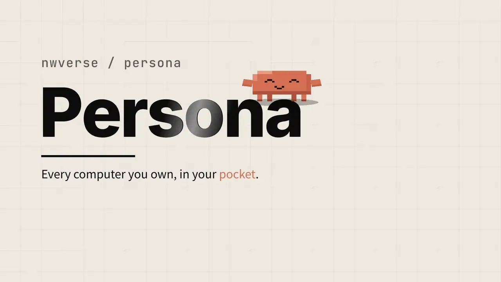

<picture>
  <source media="(prefers-color-scheme: dark)" srcset="docs/assets/readme/banner-dark.svg">
  
</picture>

English · [简体中文](README.zh-CN.md)

### One SuperAgent for everything you do. It knows your world, runs your Agents, and goes wherever you go.

      
  
 

[Try the demo](#get-started) · [Features](#features) · [How it works](#how-it-works) · [Docs](#docs)

 

<picture>
  <source media="(prefers-color-scheme: dark)" srcset="docs/assets/readme/hero-dark.webp">
  
</picture>

Demo mode with made-up data.

## Video tour

https://github.com/user-attachments/assets/1c16db32-72e3-4d74-8cbf-1976d27b0b78

[HD video and subtitles](https://github.com/nwverse/persona/releases/tag/promo-v1).

## Features

- **A SuperAgent, one entry for everything.** Ask in one chat. Persona pulls in your context, breaks the work down and hands it to Agents. [Assistant](docs/assistant/assistant.md)
- **Phone and computer, one session.** Claude Code and Codex keep running on your computers. Watch them live, answer and approve from your phone, then carry on at your desk. [Engines](docs/integrations/engines.md)
- **Extensions for everything.** Tools, Agent runtimes, data sources, channels and voice plug in, with an SDK and a market. [Extensions](docs/extensions/extensions.md)
- **Dynamic Island, Siri and Shortcuts.** Every Agent at a glance on the Lock Screen; ask, approve or start work by voice, a shortcut or your watch. [Live Activities](docs/apple/live-activity.md) · [Siri](docs/apple/siri.md)
- **Knowledge base and Inbox.** Your chats, people and projects become shared memory; Lark, mail and GitHub land in one AI-sorted Inbox. [Knowledge](docs/assistant/knowledge.md) · [Inbox](docs/assistant/inbox.md)
- **Your phone's data, in reach.** Contacts, calendar, reminders, photos, health and location become tools, and writes are confirmed on your phone. [Phone tools](docs/apple/phone-tools.md)
- **Connectors and channels.** Bring in Lark, mail, GitHub, iMessage, Telegram and WeChat; talk to Persona from the app, Lark, WeChat or by voice. [Connectors](docs/extensions/connectors.md) · [Channels](docs/extensions/channels.md)
- **Every screen.** iPhone, Apple Watch, Mac, Vision Pro, Android and the web, in English, Chinese and Japanese. [Clients](docs/apple/ios.md)

## How it works

You run a small hub on an always-on machine; your devices talk only to it, and it reaches each of your computers, where Agents run in herdr or Orca. Your data stays on your own hardware.
[Architecture](docs/server/architecture.md) · [Network and security](docs/operations/network.md)

## Get started

- **Just looking?** Install the [TestFlight beta](https://testflight.apple.com/join/vsjfy3hE) and tap **No Hub? Try the Demo**: no server or account needed.
- **Your own setup:** one command installs the hub, then scan a QR code. See [Getting started](docs/operations/getting-started.md).
- **From source:** [config](docs/operations/config.md) · [deploy](docs/server/server.md) · [contributing](CLAUDE.md)

## Docs

[Getting started](docs/operations/getting-started.md) · [Architecture](docs/server/architecture.md) · [Protocol](docs/protocol/protocol.md) · [Docker](docs/operations/docker.md) · [iOS](docs/apple/ios.md) · [Mac](docs/apple/mac.md) · [Android](docs/android/android.md) · [Web](docs/web/web.md) · [All docs](CLAUDE.md#docs-index)

## License

Persona is licensed under the [MIT License](LICENSE).

Third-party licenses: [THIRD_PARTY_NOTICES.md](THIRD_PARTY_NOTICES.md).
