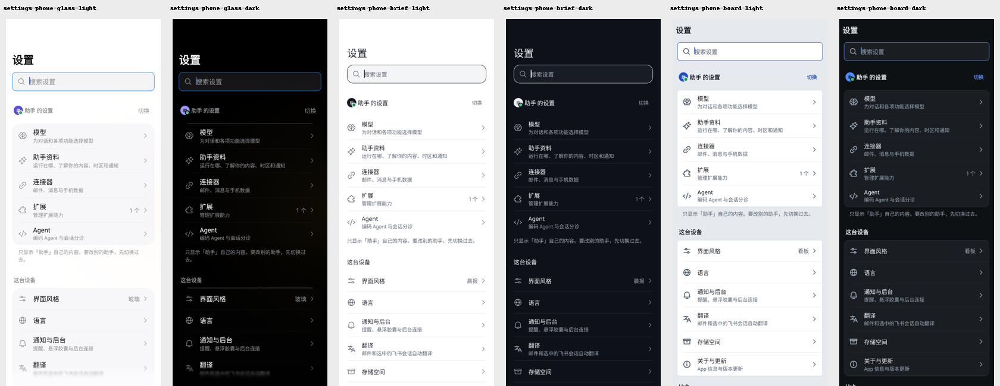
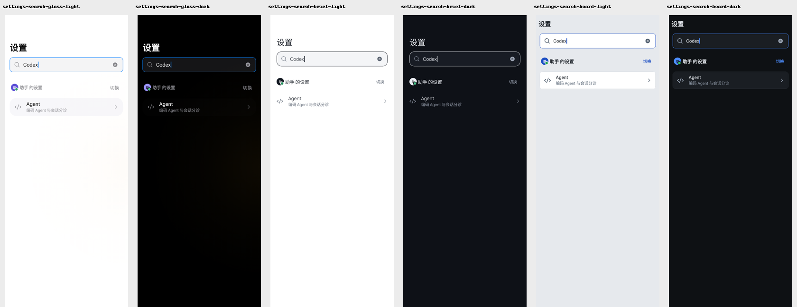
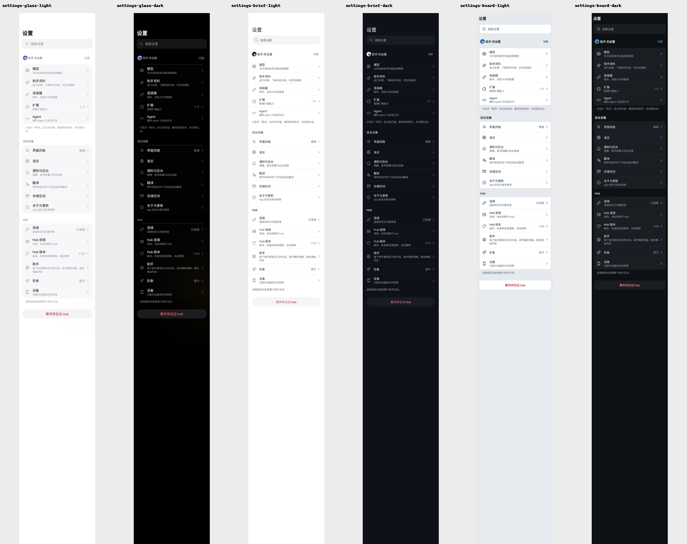
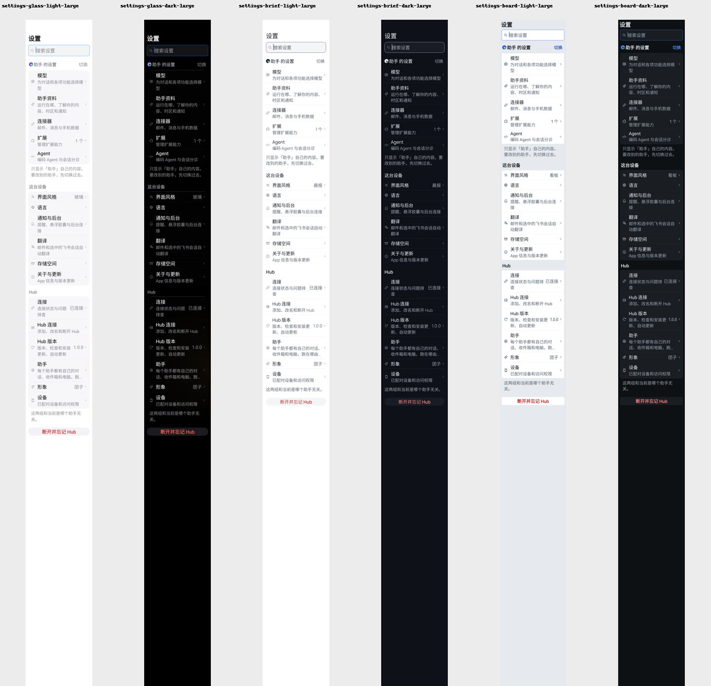
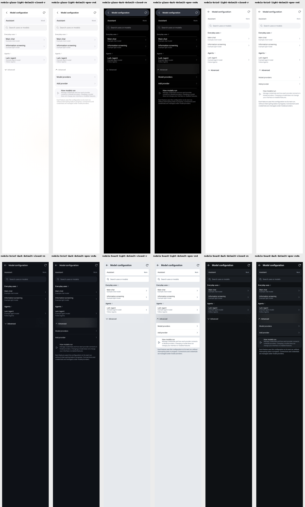
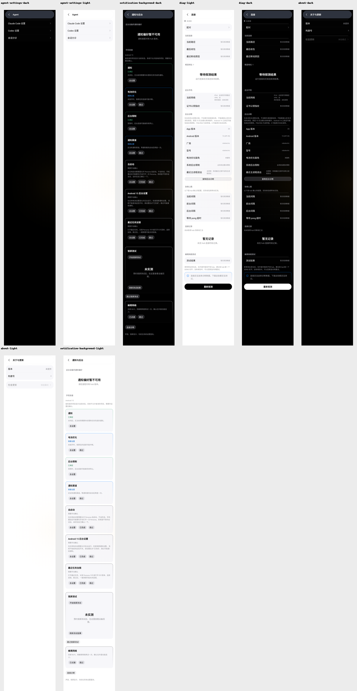

# Android Settings captures (#5233)

These are actual **Native JVM Compose renders**, generated by Robolectric with graphics mode NATIVE, API 35,
400 dp width and reduced motion. They are not emulator or handset screenshots. The synthetic assistant roster,
extension data, model names and addresses contain no personal data. PNGs retain no screenshot metadata.

The phone home and search originals are 400 × 950 dp; the tall overview shows all three scopes without scrolling.
The galleries arrange and resize those renders for review; they do not redraw the UI. `large-text-gallery.png`
uses the real Compose density at 200% font scale. Model renders cover all three styles, both schemes, folded/open
Advanced, default/200% text. The pages gallery covers the unified notification/background page, Agent, About/updates
and Connection in light/dark. Some secondary fixtures deliberately lack a live hub or notification-preference API;
those images do not establish device or live-service behavior.

## Home and search

| Style | Home light | Home dark | Search light | Search dark |
| --- | --- | --- | --- | --- |
| Glass | [PNG](settings-phone-glass-light.png) | [PNG](settings-phone-glass-dark.png) | [PNG](settings-search-glass-light.png) | [PNG](settings-search-glass-dark.png) |
| Brief | [PNG](settings-phone-brief-light.png) | [PNG](settings-phone-brief-dark.png) | [PNG](settings-search-brief-light.png) | [PNG](settings-search-brief-dark.png) |
| Board | [PNG](settings-phone-board-light.png) | [PNG](settings-phone-board-dark.png) | [PNG](settings-search-board-light.png) | [PNG](settings-search-board-dark.png) |




## Entire home and secondary pages

| Style | Entire home light | Entire home dark |
| --- | --- | --- |
| Glass | [PNG](settings-glass-light.png) | [PNG](settings-glass-dark.png) |
| Brief | [PNG](settings-brief-light.png) | [PNG](settings-brief-dark.png) |
| Board | [PNG](settings-board-light.png) | [PNG](settings-board-dark.png) |






## Reproduce

With JDK 21 and the Android SDK configured, from `android/`:

```sh
./gradlew :feature:settings:testDebugUnitTest \
  --tests persona.feature.settings.SettingsGroupsShotsTest \
  --tests persona.feature.settings.ModelConfigurationScreenTest \
  --tests persona.feature.settings.ReorganizedSettingsPagesTest
```

Originals are written under `android/feature/settings/build/settings-groups-shots`,
`android/feature/settings/build/model-configuration-shots`, and
`android/feature/settings/build/settings-reorganized-shots`. Inspect originals as well as galleries.
Additional no-match and large-text search captures are generated by the tests but omitted here to keep evidence size bounded.

Device checks still needed: system bars/IME, notification permission dialogs and system channels, manufacturer
autostart/battery settings, capsule overlays, APK installer confirmation, and live hub transport. Large navigation
changes require a person to review the captures before merge (`docs/design/DESIGN_SYSTEM.md`, section 1.4).
