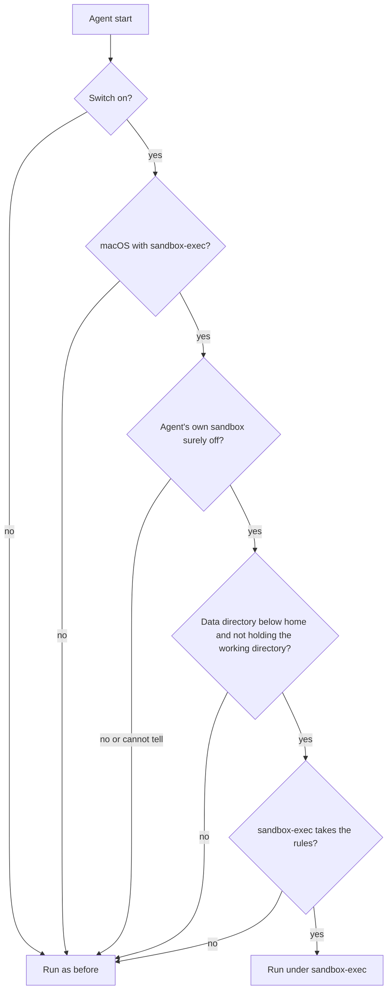

# Agent sandbox

On macOS, the agents Persona starts can run under `sandbox-exec` with everything allowed except the data directory's
secrets. It is off until you turn it on, and Linux is not supported yet (#5357).

An agent in the sandbox keeps the network, the home directory, git, ssh, compilers and the Keychain. It cannot open
`secret.key`, `hub.json` or the other credential files in the data directory (`~/.persona` or where
`PERSONA_HOME` points), by any name and from any child process.

## It closes the data directory's secrets to the agents Persona starts

Every row below fails inside the sandbox and works outside it (`TestDarwinAgentSandboxForReal` checks each one).

| An agent tries to | Result |
| --- | --- |
| Read or copy `secret.key`, `handles.key`, any other `*.key` at the top, `hub.json`, `link.json`, a TLS key | Refused, also through `~/.persona`, a symlink elsewhere, or a child process such as Python or `cp` |
| Read a backup or a copy being written (`secret.key.bak`, `hub.json.bak`, the `.hub.json.*` file a rewrite renames into place) | Refused |
| Read the Cloudflare tunnel token (`relay-tunnel.token`), the Postgres password (`docker/db-password`), or any other `*.token` / `*.secret` / `*.password` at the top of the data directory | Refused |
| Read a manager's folder (`managers/`) or an extension's sign-in data (`extensions/data/`) | Refused |
| Read another launcher's merged settings in `launcher-settings/` | Refused; the files this start passes to its own agent stay readable |
| Connect to an extension's proxy socket or the hub's edge socket (`extensions/run/`, `run/`) | Refused |
| Rename the data directory, a folder above it, or `extensions/` (which holds `extensions/data/` and `extensions/run/`), or replace the `~/.persona` link | Refused, so the secrets cannot be moved out from under the rules (#6117) |
| Remove the switch file `agent-sandbox.on` | Refused |
| Read `launch.key`, which `personad launch` needs before the node hands out a managed launcher's settings (`launcher.env` on `node.sock`, #5588) | Refused, so the node refuses an agent any launcher's settings |

A listing such as `ls -l ~/.persona` still shows the secret files' names, sizes and times; only their contents are
closed. Persona's own files stay usable: `node.sock` (hooks and MCP), `mcp.json`, `claude-settings.json`, `bin/`, the
assistant's directories, the knowledge base in `data/`, and `personad` itself.

## Some ways to the secrets stay open

The sandbox covers only the processes Persona starts in it. These reach the secrets anyway:

- **Docker.** An agent that can run `docker` can mount the data directory into a container and read it there.
  `personad hub setup` runs Postgres in Docker, so Docker is there on most hub machines. Closing the Docker socket
  would take Docker away from every agent, so the sandbox leaves it open.
- **Terminals and scripts you start yourself**, and agents Persona does not start: Paseo, DSH and other runtimes,
  daemons, botmux, sessions Herdr App or Orca open themselves, the Codex desktop app.
- **Starts this version does not wrap**: an agent started in herdr or Orca, or resumed after herdr restarts, by a
  launcher other than `personad launch` (plain `claude`, a `~/.zshrc` alias or function); Codex conversations on the
  assistant; a plain `codex` (see "A start is wrapped only when the agent's own sandbox is surely off"). While the
  switch is on, the node records each such herdr or Orca start as `skipped` under `pane`, so the doctor warns; a later
  start there through a managed launcher clears it.
- **Code that runs later outside the sandbox**: files an agent writes for another program to run (shell startup
  files, LaunchAgents, git hooks), and programs outside the sandbox it can drive (`open`, `osascript`, `launchctl`,
  herdr's or tmux's sockets, `ssh localhost`).
- **The hub's API** with a token an agent already has, and **`~/.ssh`** keys.

## Four starts are wrapped

`sandbox.WrapAgent` puts `/usr/bin/sandbox-exec -p <profile>` in front of the command and `PERSONA_AGENT_SANDBOXED=1`
in its environment. The process keeps its pid, so the node still recognizes the agent by it.

| Start | Started by | Code |
| --- | --- | --- |
| The assistant's Claude on the CLI with plain `claude` or a `~/.zshrc` launcher, guests included | the node | `assistantCLICommand`, `server/internal/node/assistant_start.go` |
| The assistant's Claude on the Agent SDK: the bridge and the claude it starts | the node | `sdkCommand`, `server/internal/node/assistant_sdk.go` |
| A managed launcher, `personad launch <name>`: in herdr, for the assistant, and when the node checks a launcher | a pane's shell, or the node | `launchExec`, `server/internal/node/managed.go` |
| A Codex started from the phone, `personad codex-start` | the pane's shell | `codexStartExec`, `server/internal/node/codex_start.go` |

`personad launch` itself stays outside the sandbox: it reads `launch.key` and fetches the launcher's settings from the
node first, then wraps only the agent it execs. So for a managed launcher the assistant does not wrap its shell, and
`personad launch` wraps the claude it starts. A start inside the sandbox (`PERSONA_AGENT_SANDBOXED=1` in its
environment) runs as it is: the sandbox is inherited, and a second `sandbox-exec` inside it would fail.

## A start is wrapped only when the agent's own sandbox is surely off

`sandbox-exec` cannot apply a profile inside another one that denies anything: the inner one exits 71 with
`sandbox_apply: Operation not permitted`. Claude Code's own sandbox and Codex's `read-only` and `workspace-write` modes
use it, so wrapping them would break every command they run. When Persona cannot tell, it does not wrap, and the doctor
says why.



Every "Run as before" except the first records why (`skipped`, `unsupported` or `unavailable`) for the doctor.

- **Claude** is wrapped when nothing sets `sandbox.enabled` to `true`: `settings.json` in `CLAUDE_CONFIG_DIR` or
  `~/.claude` (on the node, in every Claude config directory it knows), `.claude/settings.json` and
  `.claude/settings.local.json` in the working directory and each folder above it,
  `/Library/Application Support/ClaudeCode/managed-settings.json` and `managed-settings.d/`, and `--settings`. A file
  that is there but cannot be read counts as on.
- **Codex** is wrapped when it runs `danger-full-access` in its own process. A plain `codex` 0.163 runs its tools in the
  shared app-server daemon, which wrapping the terminal UI does not reach, so the launcher needs one of the flags that
  keep it in its own process (`-c`, `-p` and the rest of `codexConfigFlags`). The mode is read in Codex's order:
  `--dangerously-bypass-approvals-and-sandbox`, `-s` or `--full-auto`, the profile's `sandbox_mode`, `-c sandbox_mode`,
  then `config.toml` in `CODEX_HOME`. A project's `.codex/config.toml`, `/etc/codex/managed_config.toml` or
  `requirements.toml`, a profile written as a dotted key, and `--remote` all count as cannot tell.
- **Other agents** (`agy` and the rest) are not wrapped until their own sandboxes have been checked.

The data directory check exists because the rules match names in it: with `PERSONA_HOME=~` they would reach every
`hub.json` or `*.pem` in the home's top level. Persona's own working directories inside it (`assistant/`, `health/`,
`guest/`) are fine.

## The rules close names at the top of the data directory and a few folders whole

The profile starts from `(allow default)` and adds denials, all on real paths (`/tmp` is `/private/tmp`); each name the
data directory goes by is resolved and written once.

| Rule | Covers |
| --- | --- |
| Read and write, by the start of the name, with an optional leading dot, and anything inside a folder by such a name | `identity.DataSecrets` at the top: `hub.json`, `link.json`, `tailcat.json`, `tailcat-hub.json`, `daemons.json`, `manager.json`, `apns`, `relay.json`, `relay.secret`, `relay-tunnel.token`, `devices.json`, `mail_accounts.json` |
| Read and write, key and credential files with their backups | `identity.DataCredentialPattern` at the top: `\.(key|p8|pem|crt|token|secret|password)([.~-][^/]*)?$` |
| Read and write, whole folders | `identity.DataSecretDirs` (`launcher-settings/`, `tls/`, `link-tls/`, `docker/`, `extensions/data/`, `extensions/staging/`, `plugins/`, `node-plugins/`), and `managers/`, `extensions/run/`, `run/`; connecting to the sockets in `extensions/run/`, `plugins/run/` and `run/` |
| Connect | Unix sockets under `extensions/run/` and `run/` |
| Write | The data directory itself, every folder above it, its other names (the `~/.persona` link), every folder in it that holds a closed folder (`extensions/`), `agent-sandbox.on` |
| Allow read | This start's own files in `launcher-settings/` (what it passes with `--settings`) |

The node's path guard (`server/internal/node/pathguard.go`, which decides what a phone or web client may read by path)
takes the same list from `server/internal/identity/secrets.go`. They differ here, and `TestAgentSandboxCoversPathGuard`
pins each difference:

| Path in the data directory | Path guard | Agent sandbox |
| --- | --- | --- |
| `managers/<id>/` | The same names, keys and folders at its top | The whole folder |
| `.hub.json.*` and other dot-prefixed copies | Readable | Refused |
| `extensions/run/`, `run/` | Readable | Refused, sockets included |
| This start's own launcher settings | Refused | Readable |
| A manager's folder outside the data directory (`--dir`, one holding a manager's `manager.json`) | The same names, keys and folders at its top | Not closed |

Neither matches a name deeper in the data directory, so a project's own `link.json` or `certs/dev.pem` below it stays
readable.

## Known side effects

- **setuid programs do not start**: `ps`, `top`, `sudo`, `su` and `crontab` fail with `Operation not permitted`. `pgrep`
  and `lsof` work.
- **`personad launch`, `personad extension …` and `personad hub admin …` fail in an agent**: they read `launch.key` or
  the hub's token in `hub.json`.
- **Each wrapped start runs `sandbox-exec` once more**, with `/usr/bin/true`, to check the rules before the real start;
  it takes about 10 ms, and the node remembers the answer for the same rules.

## The switch is a file in the data directory

Turn it on or off for every process on the machine with the file, then start the agent again; running agents keep how
they started. Before you turn it on: it does not stop Docker (see "Some ways to the secrets stay open"), it does not
cover agents started in herdr or Orca without a managed launcher, and `ps`, `top` and `sudo` stop working in agents.
`personad node doctor` repeats all three while it is on.

```sh
touch ~/.persona/agent-sandbox.on   # on (use PERSONA_HOME's directory for a custom root)
rm ~/.persona/agent-sandbox.on      # off
```

`PERSONA_AGENT_SANDBOX` (`on` or `off`, also `1`, `0`, `true`, `false`) overrides the
file for the process that reads it. Each start reads it in a different place:

| Start | Reads the variable from |
| --- | --- |
| The assistant, CLI and Agent SDK | The node's environment: for the resident node, `EnvironmentVariables` in its LaunchAgent (`~/Library/LaunchAgents/com.persona.node.plist`), read when the node restarts |
| `personad launch`, `personad codex-start` | The shell of the herdr or Orca pane (the node's, when the node checks a launcher) |
| `personad node doctor` | The terminal it runs in |

A `PERSONA_HOME` set only for the node does not reach a pane's shell, which then looks for the file in
`~/.persona`. Configure the same `PERSONA_HOME` in both the resident node's LaunchAgent and the pane's shell when using a custom root.

## When something breaks, turn it off and start again

1. Run `personad node doctor`. The `agent-sandbox` line says whether the sandbox is on, whether this Mac can run it,
   and the last result of each kind of start, with the reason when a start was not wrapped.
2. Remove `agent-sandbox.on`, or set `PERSONA_AGENT_SANDBOX=off` for one shell, and start the agent again. Nothing else
   changes: no data moves and no file is rewritten.

A start the sandbox cannot set up runs unwrapped: the agent starts as before, and the reason goes to the pane
(`personad launch: agent sandbox: … not wrapped`) or the node's log, and to `agent-sandbox-status.json` in the data
directory, which the doctor reads.

## Tests run only on a Mac

`TestDarwinAgentSandboxForReal` (`server/internal/extension/sandbox/agent_test.go`) runs shell commands under the real
profile in a fake data directory and checks both what must fail and what must work. CI has no macOS runner, so it runs
locally: `go test ./internal/extension/sandbox/ -run ForReal -v` in `server/`. Apple marks `sandbox-exec` deprecated and
does not document its profile language, so run this test after a macOS update.
