# Workspace naming preview captures

Synthetic examples for #7100 and PR #7121. Captured from implementation commit
`0d24c6cad7df4fa5d0573a2099a5bdc1329d9d1b` using the real isolated
Manager HTTP/PostgreSQL fixture and Chromium. Node metadata and unrelated hub
routes are synthetic; no production data, model or Engine is involved.

The maintained browser journey is `web/e2e/workspace-naming.mjs`; its opt-in
server fixture is `server/internal/assistant/workspace_naming_browser_test.go`.
This evidence run additionally captures both surfaces at 100% and 200% text.
The viewport widths are 1440px and 390px. Images crop the editor; a taller
capture viewport keeps each scrolling editor fully visible. All images were
individually inspected by the implementing agent. Large-change human review
remains a separate pre-merge requirement.

Settings show the root layout; per-task previews show two repository subfolders.
At 200% phone text, settings also show the container layout. Native input/select
values keep their standard single-line behavior; preview paths wrap.

## Settings, 1440px, 100% text

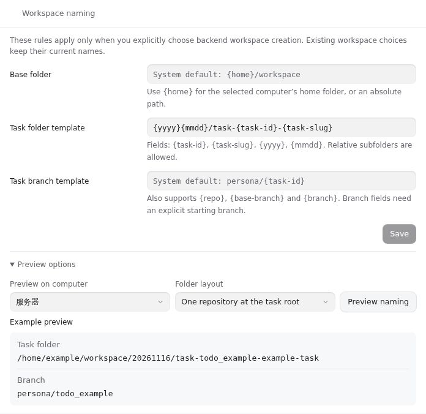

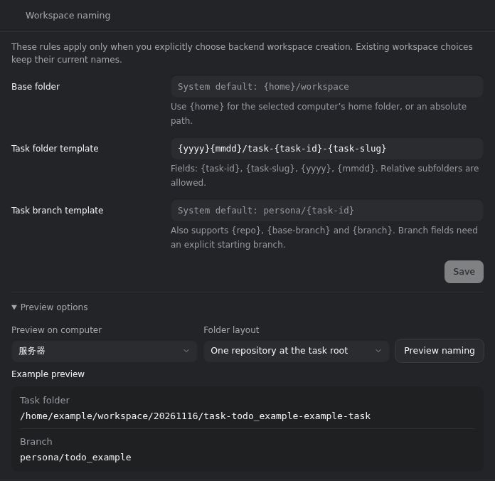

## Settings, 1440px, 200% text

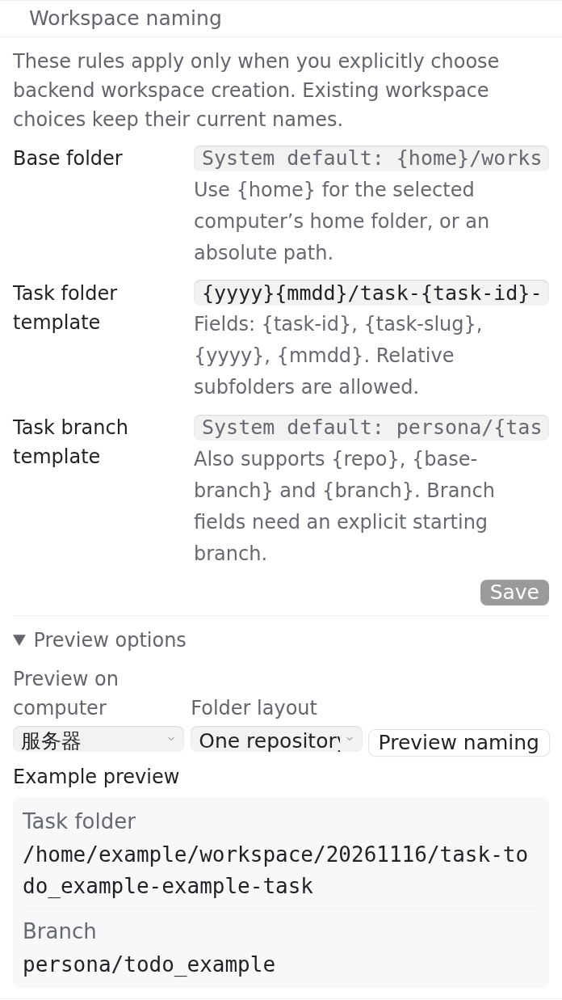

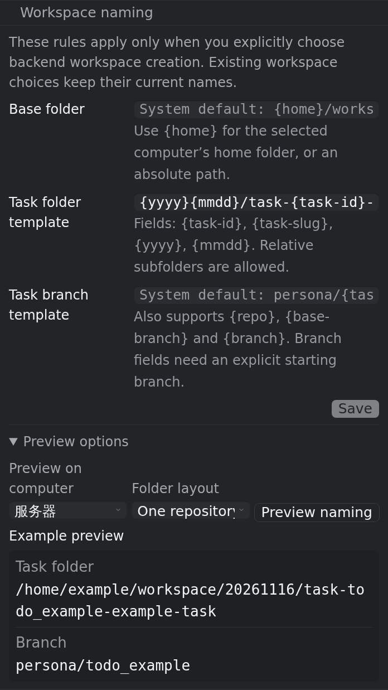

## Settings, 390px, 100% text

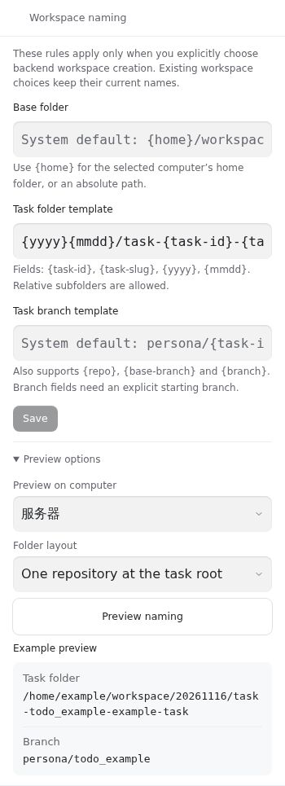

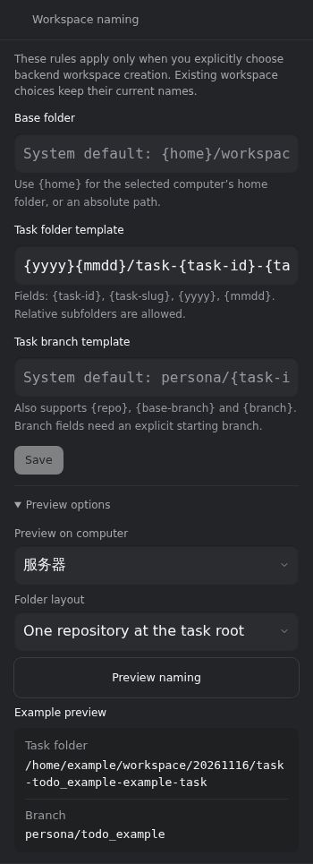

## Settings, 390px, 200% text

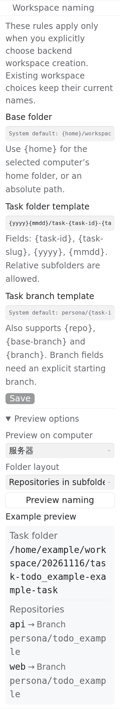

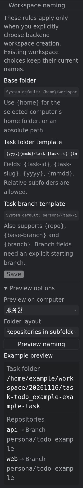

## Task, 1440px, 100% text

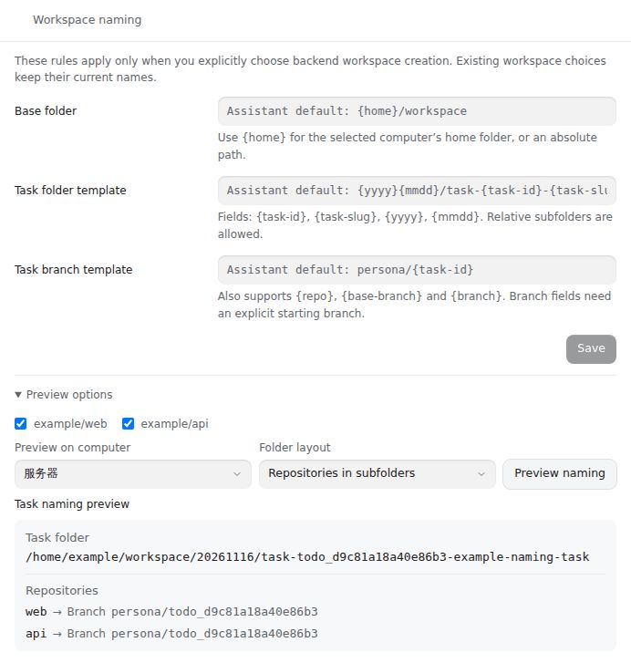

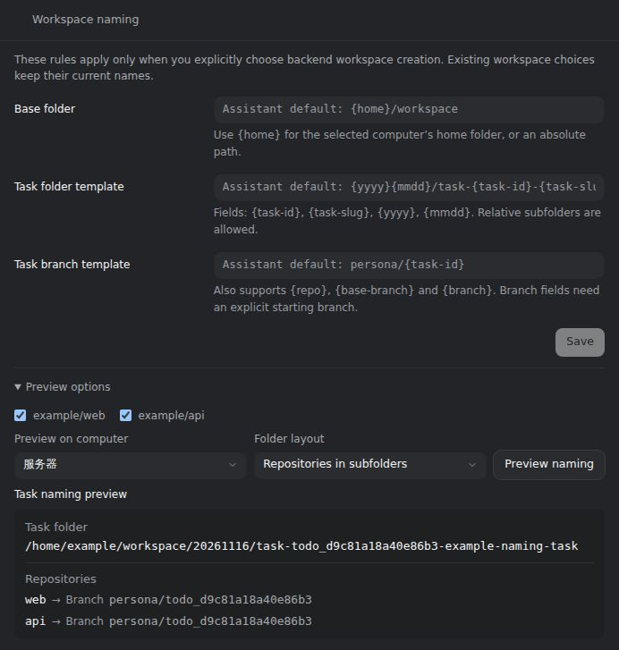

## Task, 1440px, 200% text

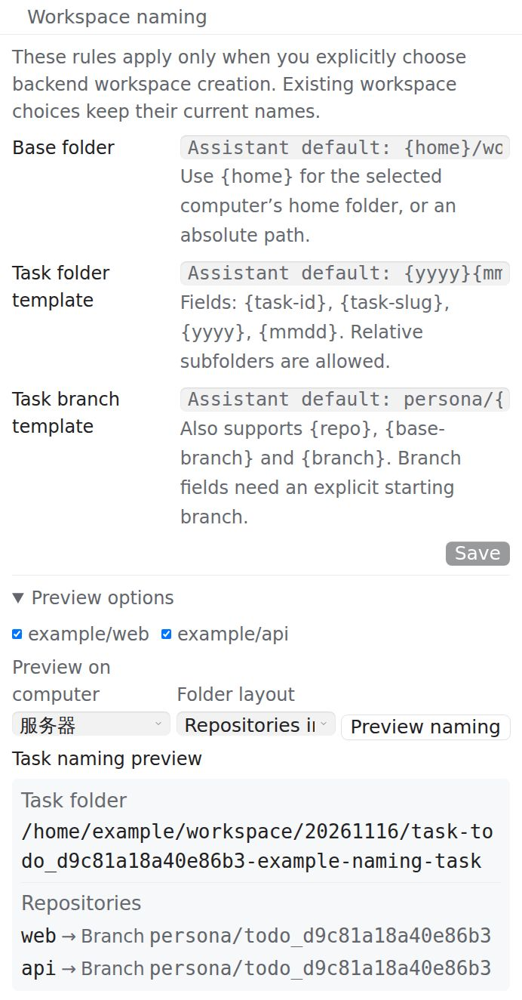

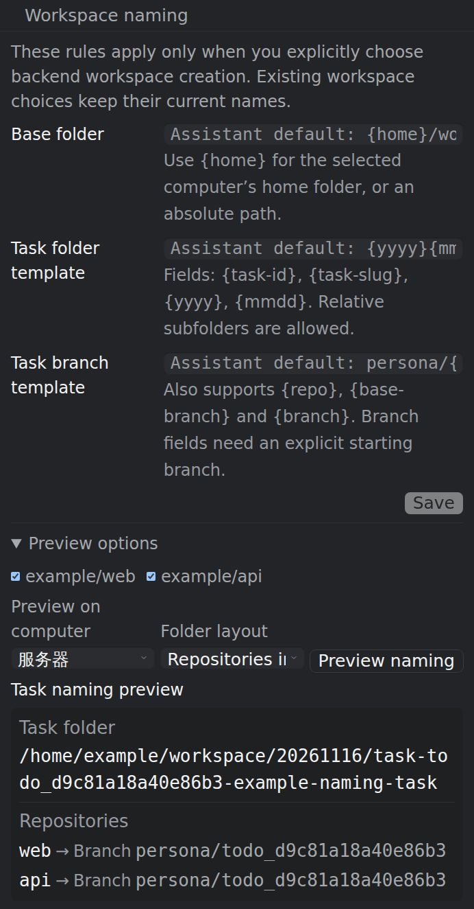

## Task, 390px, 100% text

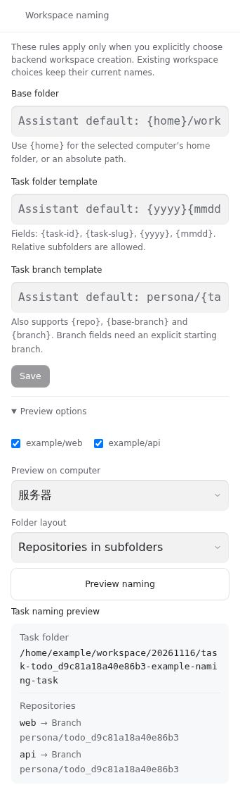

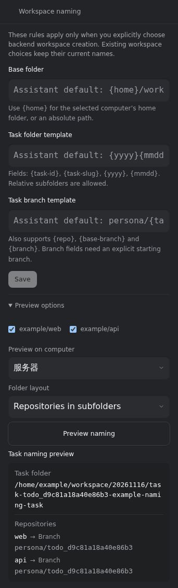

## Task, 390px, 200% text

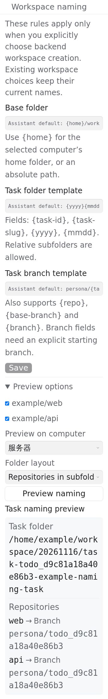

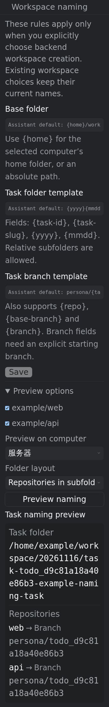
