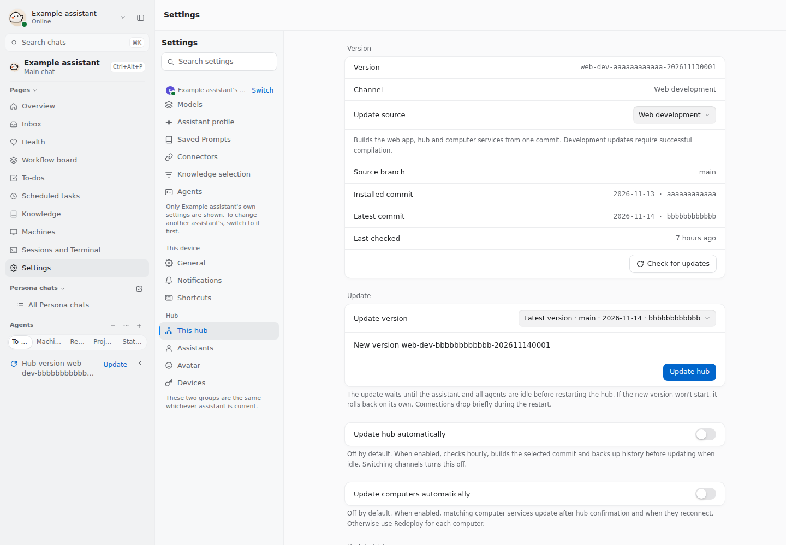
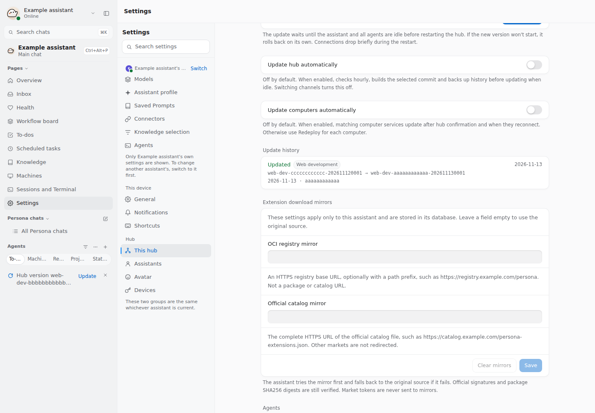
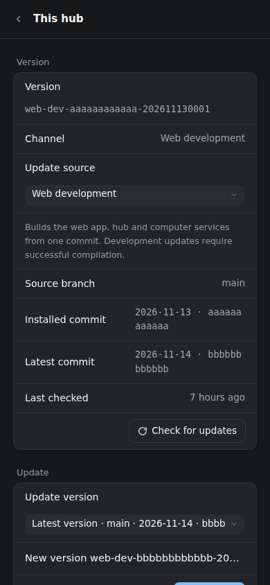
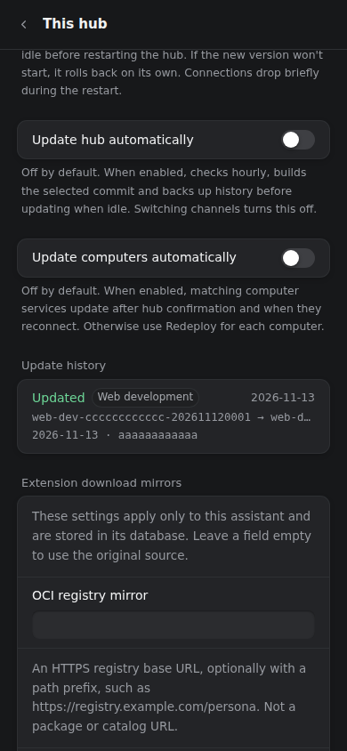
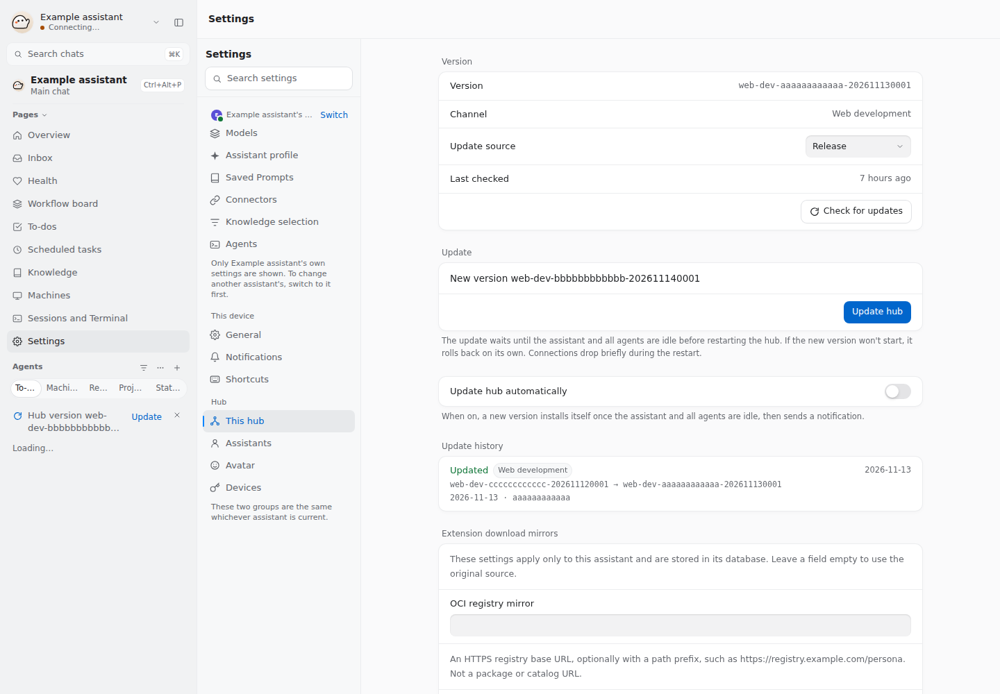
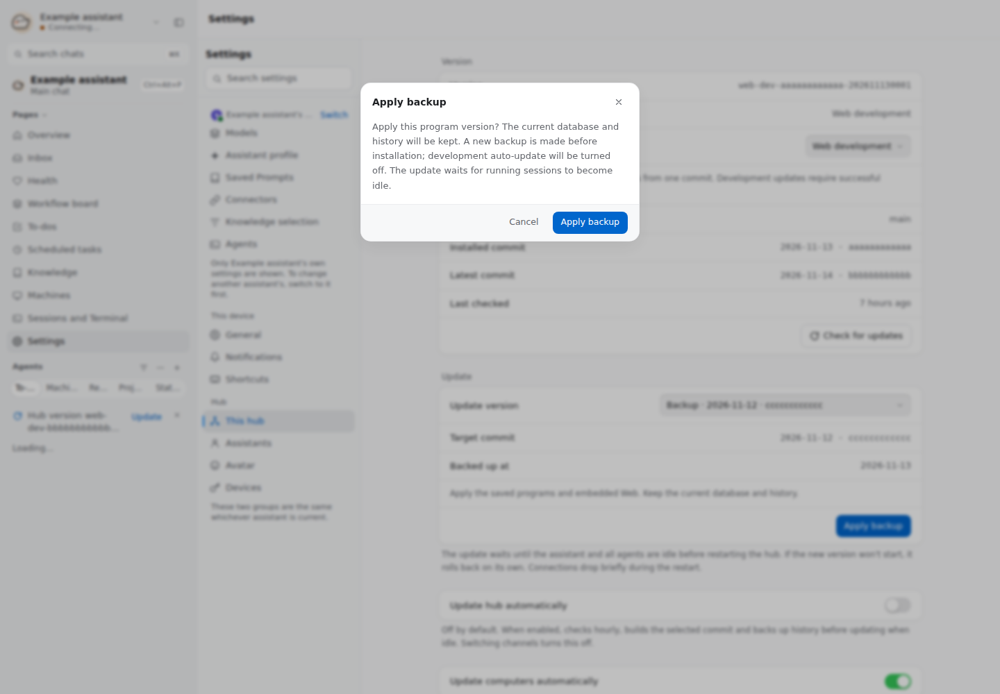
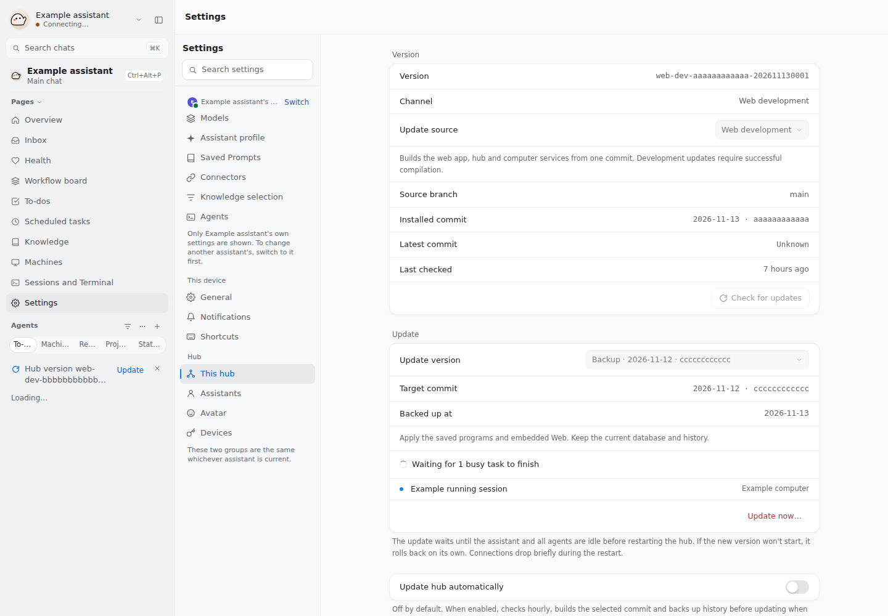
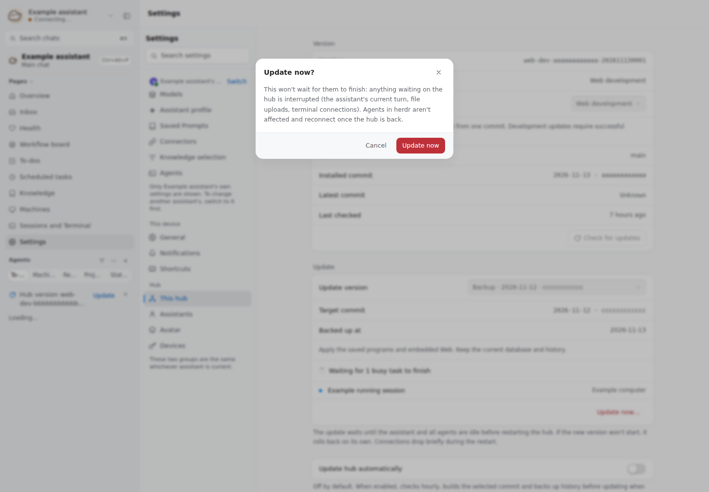
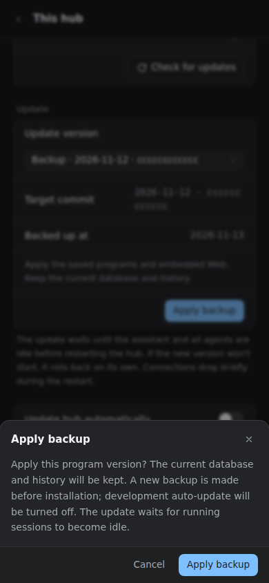

# Web update release-pinning synchronization evidence

Source: `842e648de66979d714cc362254f3b71081d27231`, ordinary merge of pinned upstream `293b31e844ddc5d256ca4a6cd2d922736b2f8e7a`.
Web source tree: `a34846ab21d81d5099ea50c134632a59be576456`.

Ten fresh captures of the actual App/Hub settings with synthetic local API data. Wide light uses Standard; narrow dark uses the Web maximum Large. Source, automation, program-only backup, idle wait and interruption-confirmation assertions passed. No uncaught page errors or page-width overflow. All ten captures were visually inspected by the author. Browser Use separately read the rendered source/version controls.

The runner reduces the existing `web/e2e/hub-development.mjs` matrix without changing its assertion bodies. Run the fixture with `PORT=<port> node web/e2e/hub-development-fixture.mjs`, then run the [runner](browser-smoke.mjs) against that owned loopback origin and a disposable output directory, supplying `--executable <chromium>`. See the [source/interaction manifest](capture.json) and [checksums](SHA256SUMS).

The capture-adding commit is immediately followed by removal of these review files, leaving the integrated source tree unchanged. Historical full galleries retain their original source bindings. These author checks do not establish production updates, writer-hook/restoration acceptance, native-host runtime or maintainer visual approval.

## 1440-light-standard-source

## 1440-light-standard-options

## 390-dark-large-source

## 390-dark-large-options

## automatic-enabled

## release-source

## backup-confirm

## backup-waiting

## interrupt-confirm

## backup-confirm-narrow-dark-large

