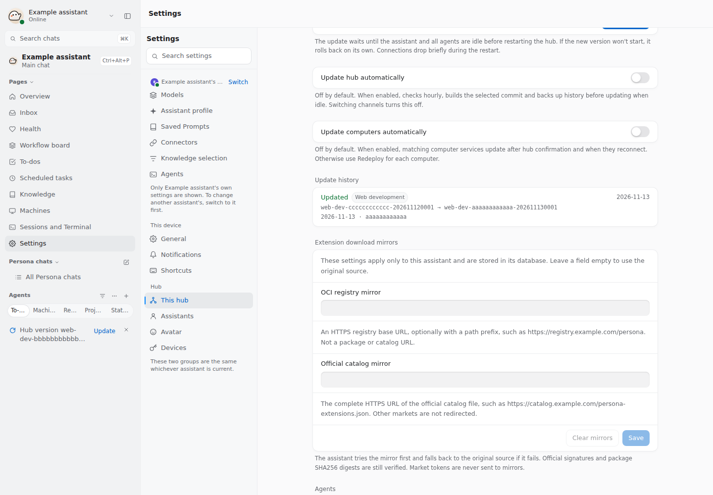
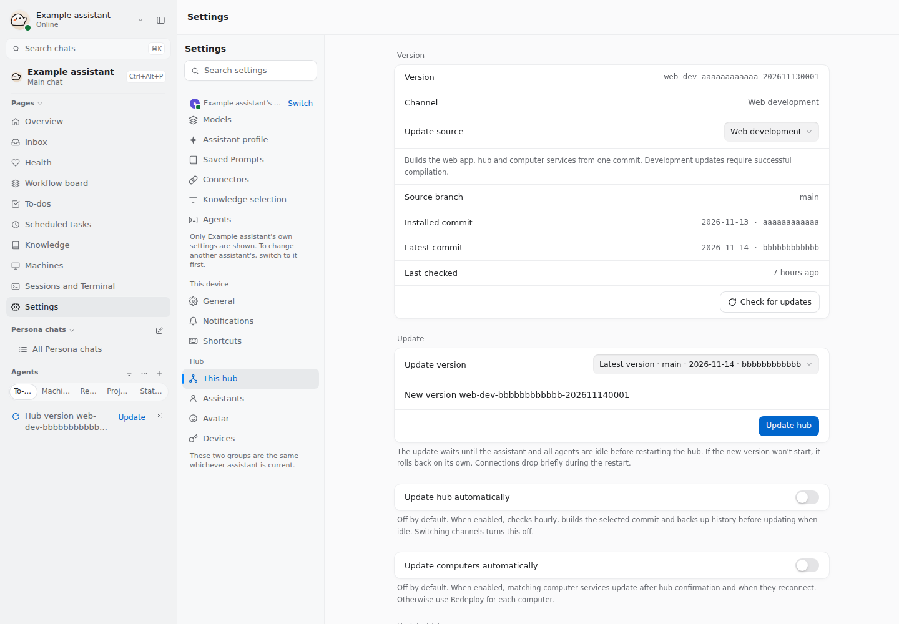
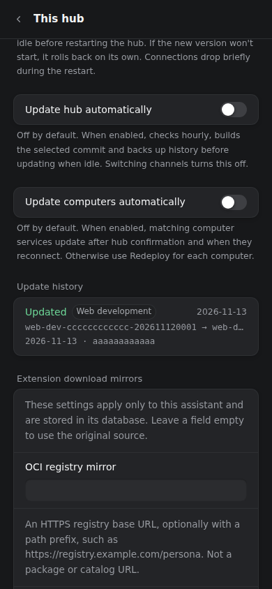
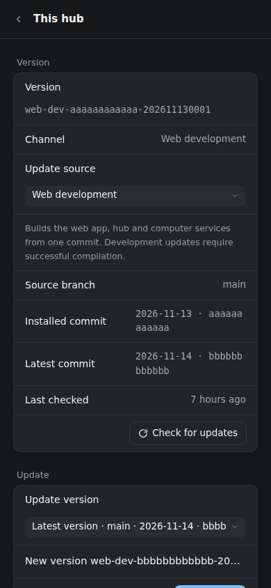
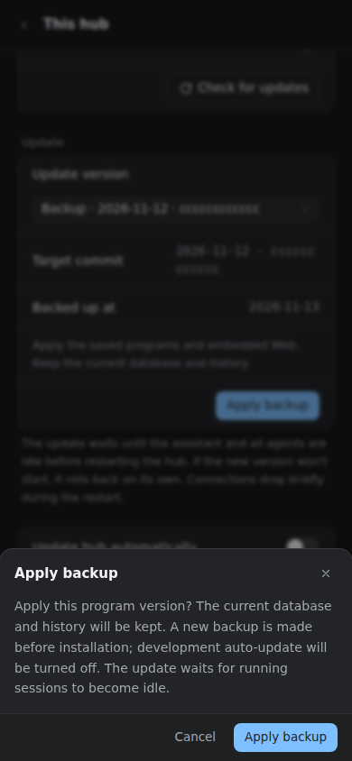
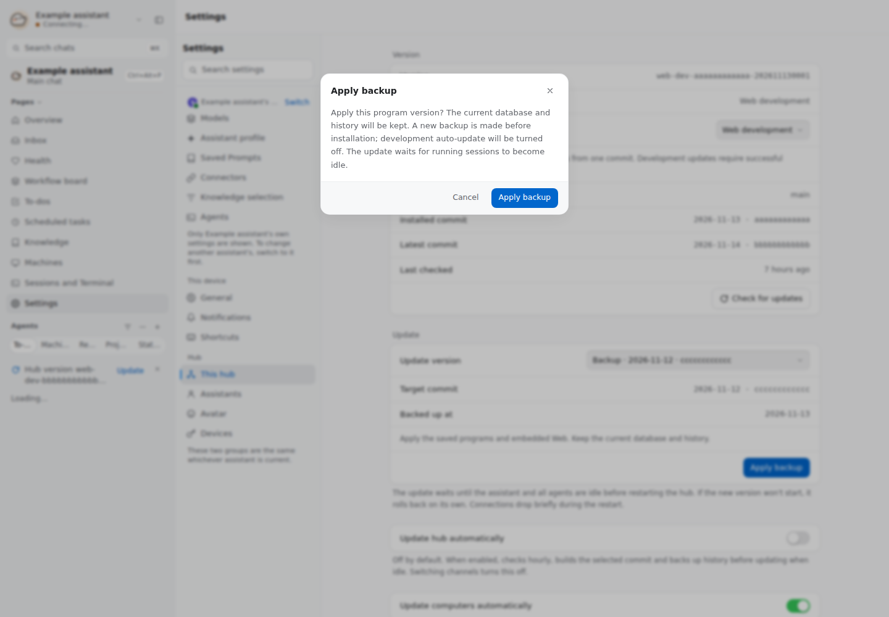
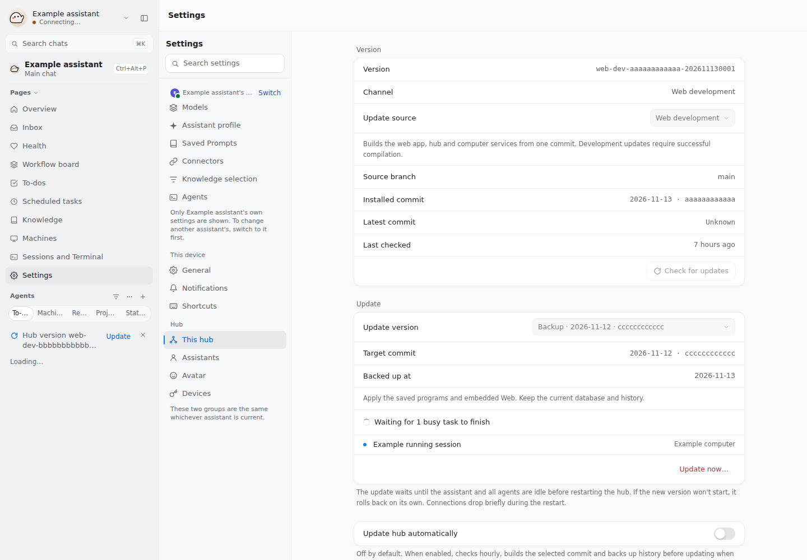
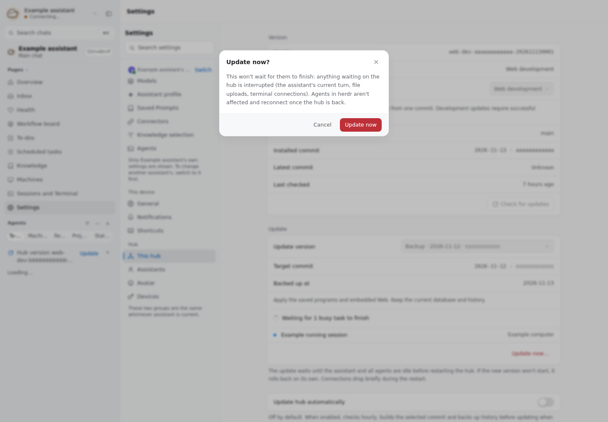
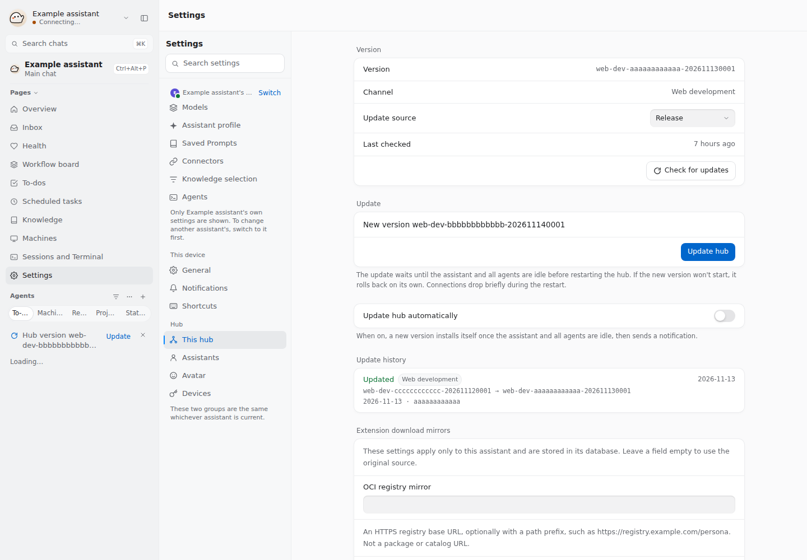

# Web update synchronization evidence

Capture source: `81ccd8010e09a2f2af8db1e6ec4efde70d7e95b3`.
Integrated source: `410f382a2f47b7c054064dfb626d3a17c2aab062`, including upstream `fbf032bb47b9955fc0a0589c23e9b576a9321cfd`.
Both have Web source tree `6072a45e1f9c1d0ca61b47e75eb931fd50e04e09`.

Ten focused captures of the actual App/Hub settings with synthetic local API data. Wide light uses Standard; narrow dark uses the Web maximum Large. Source, automation, program-only backup, idle wait and interruption confirmation assertions passed. No uncaught page errors or page-width overflow; every capture was visually inspected by the author. See [capture.json](capture.json), [checksums](SHA256SUMS) and [runner](browser-smoke.mjs). The runner narrows the existing `web/e2e/hub-development.mjs` matrix without changing its assertion bodies.

The final upstream increment only adds Android code/docs; it changes no Web, server, integration or backup-test file. The capture commit is immediately followed by removal of these review files, leaving the integrated source tree unchanged. The PR retains historical full matrices at their original source commits; this focused run does not relabel or replace them. This is author evidence with a synthetic API, not production update, writer-hook or restoration acceptance, native-host validation or maintainer approval.

## 1440-light-standard-options

## 1440-light-standard-source

## 390-dark-large-options

## 390-dark-large-source

## automatic-enabled

## backup-confirm-narrow-dark-large

## backup-confirm

## backup-waiting

## interrupt-confirm

## release-source

