# Final synchronized Web development update captures

Source commit: `f40d374b1ea433c85a41a886d51a0abe8d38225b`. Web source tree: `638a6b8ea92547860909589c9995929cfb2186e7`.

Chromium 149.0.7827.55, linux, Node v24.20.0. Full App against synthetic local API; no production data/services.

29 fresh captures: 1440x1000 / 390x844, light/dark, Standard/maximum Web Large. Source/automation/backup/idle/forced-confirm interactions passed; no uncaught browser errors or page overflow. Every image inspected by the author; this is not maintainer approval.

capture.json records source binding and interactions. SHA256SUMS binds the images.

## 1440-dark-large-options

## 1440-dark-large-source

## 1440-dark-standard-options

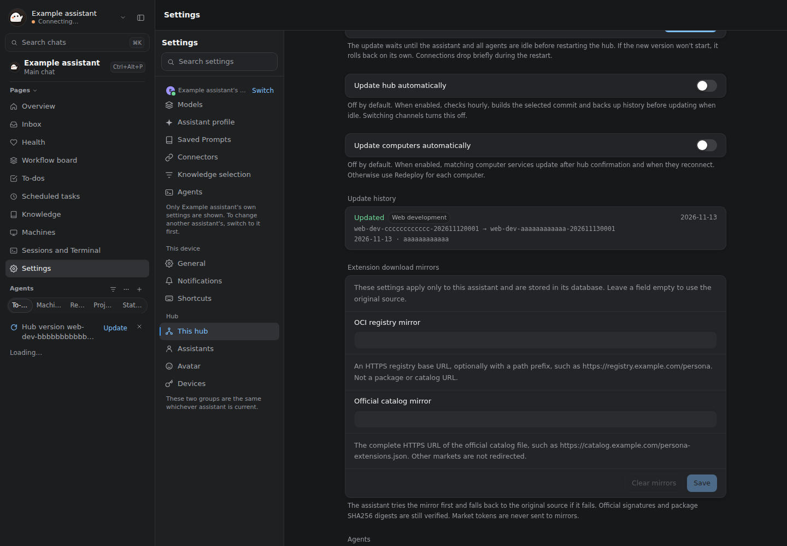

## 1440-dark-standard-source

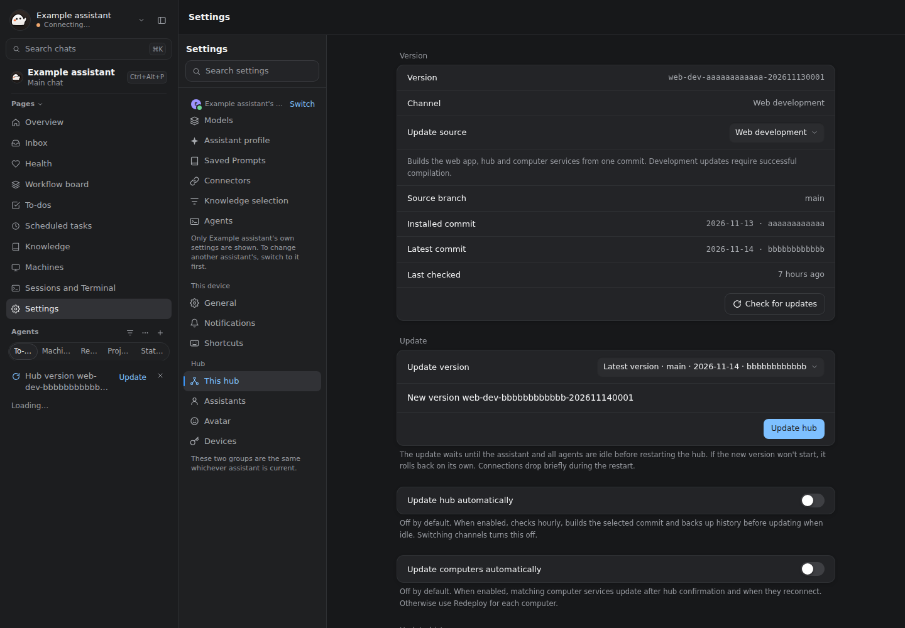

## 1440-light-large-options

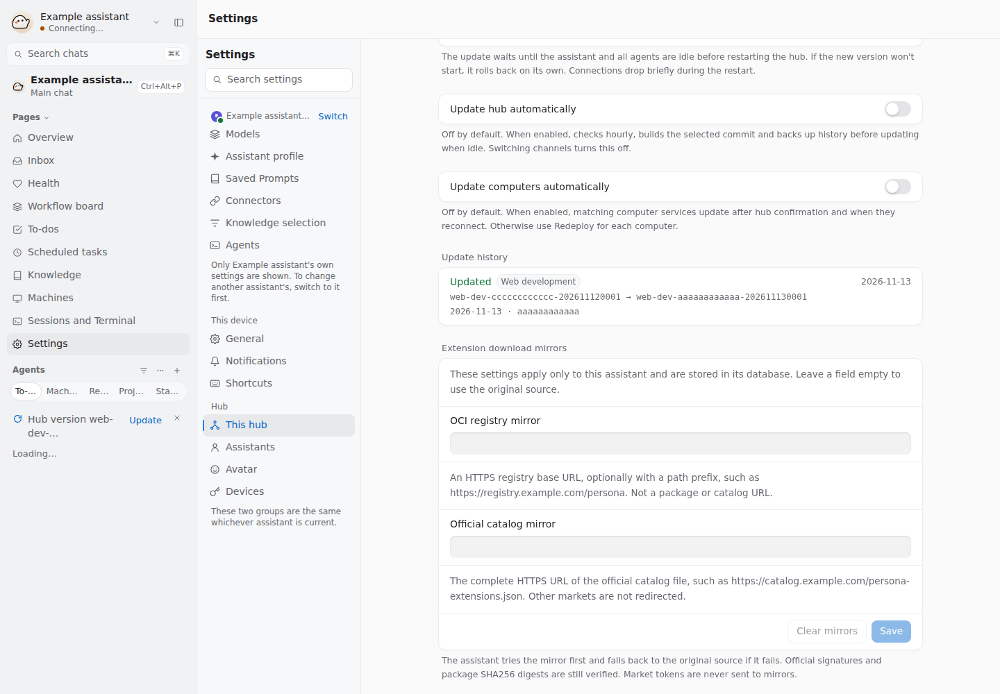

## 1440-light-large-source

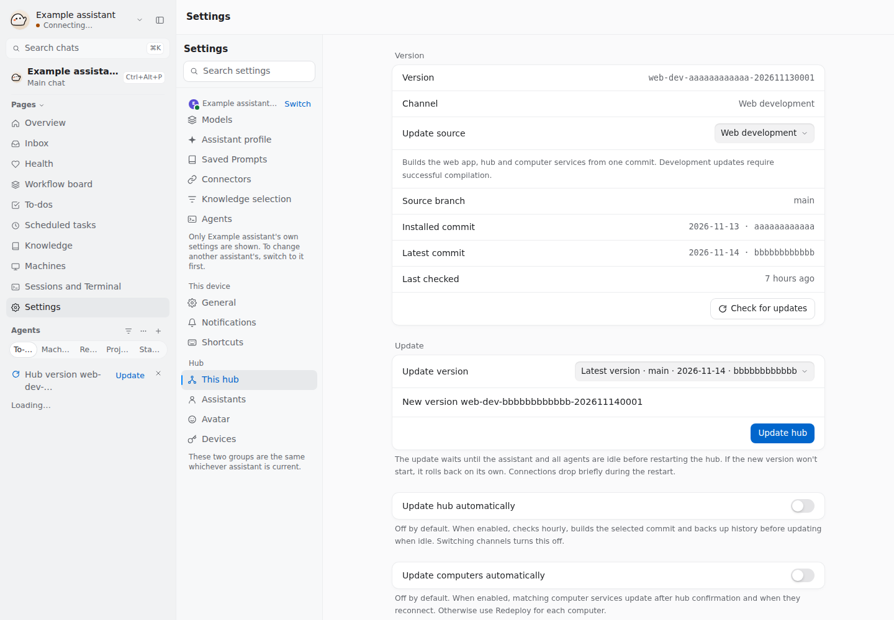

## 1440-light-standard-options

## 1440-light-standard-source

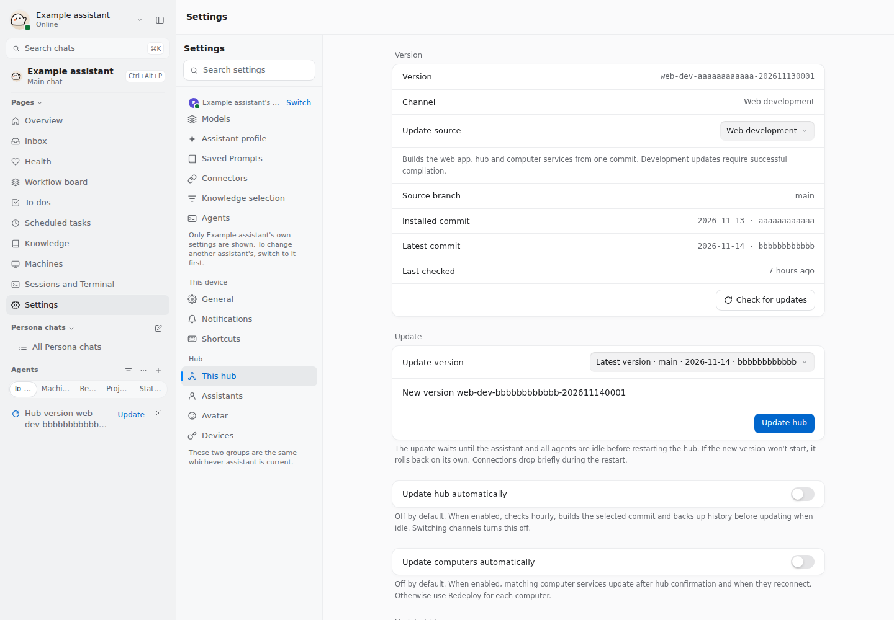

## 390-dark-large-options

## 390-dark-large-source

## 390-dark-standard-options

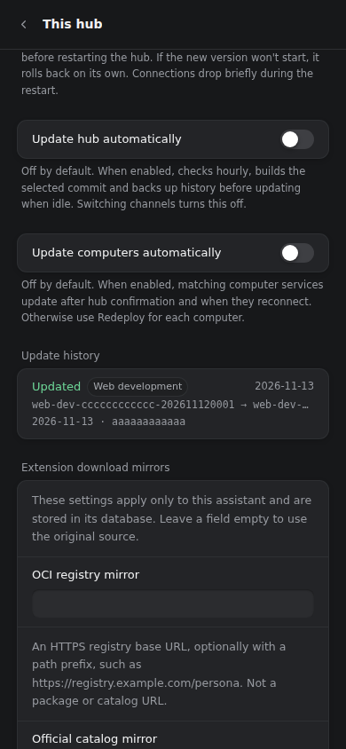

## 390-dark-standard-source

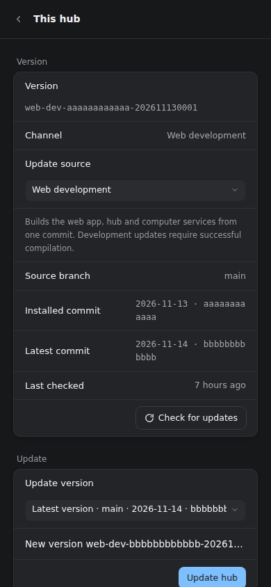

## 390-light-large-options

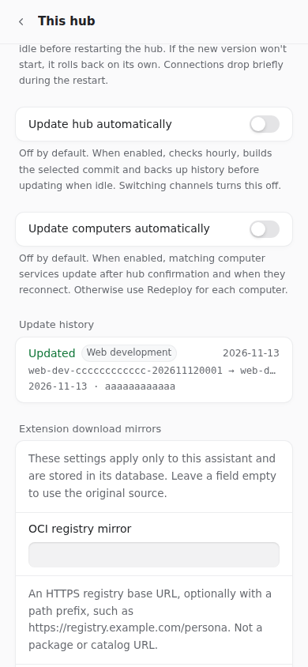

## 390-light-large-source

## 390-light-standard-options

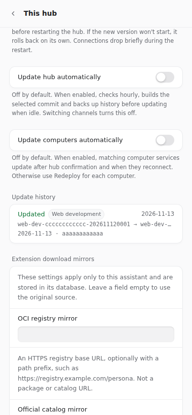

## 390-light-standard-source

## automatic-enabled

## backing_up-large

## backup-confirm-narrow-dark-large

## backup-confirm

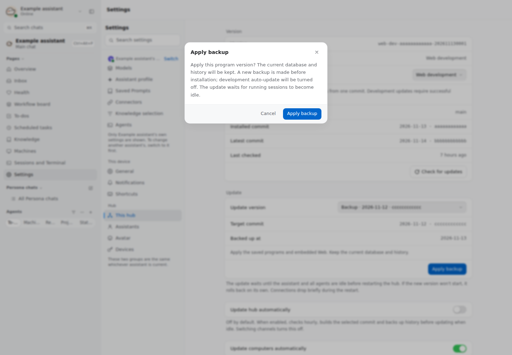

## backup-error-large

## backup-waiting

## building-large

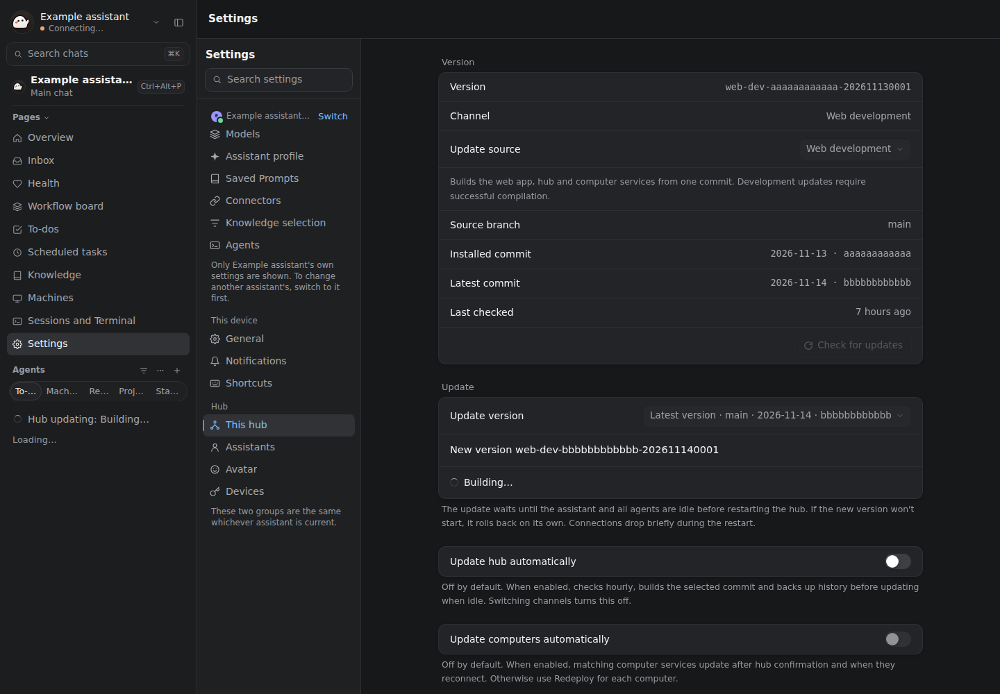

## failed-large

## interrupt-confirm

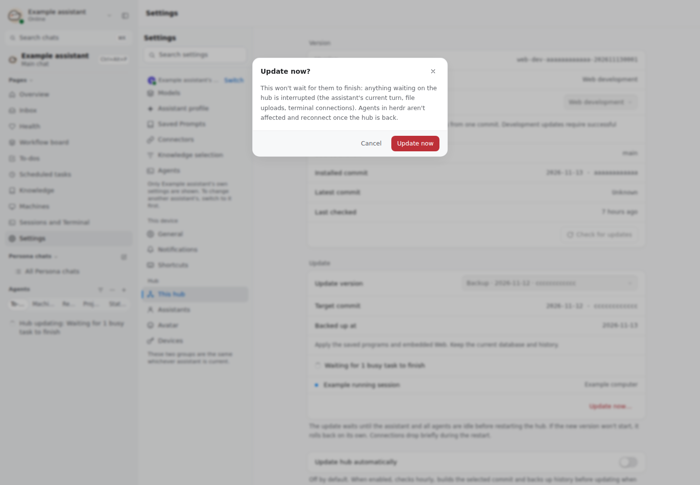

## release-source

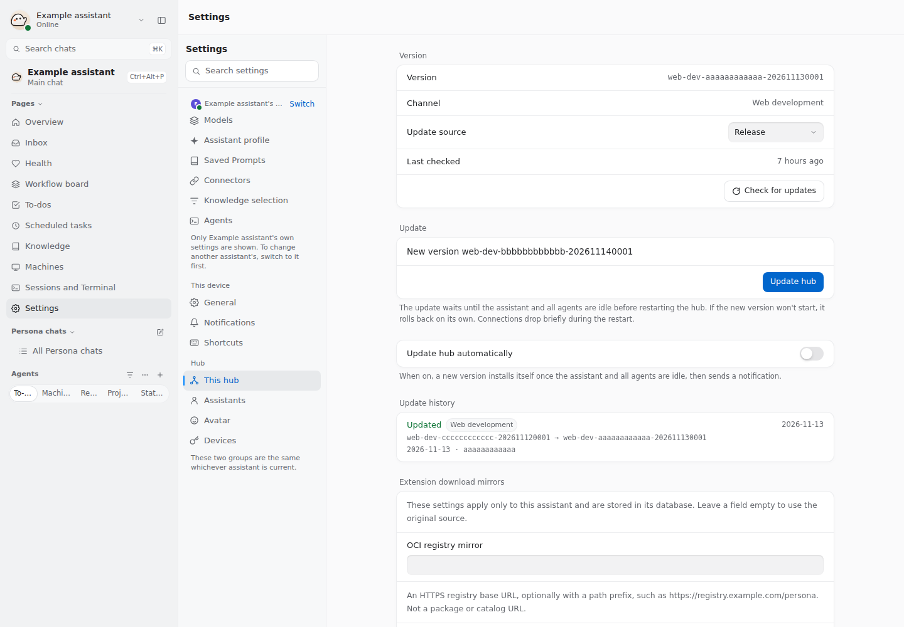

## rollback-history-large

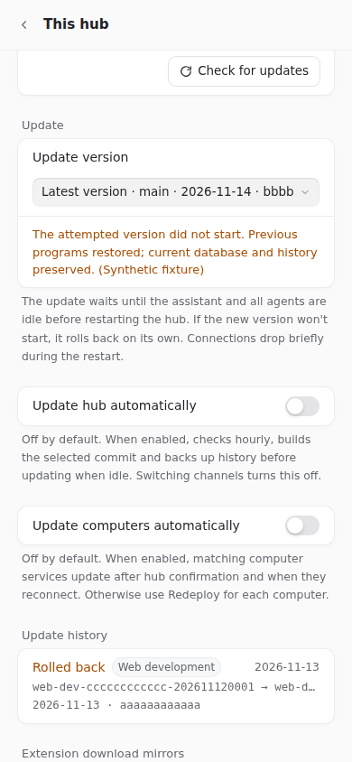

## rolled_back-large

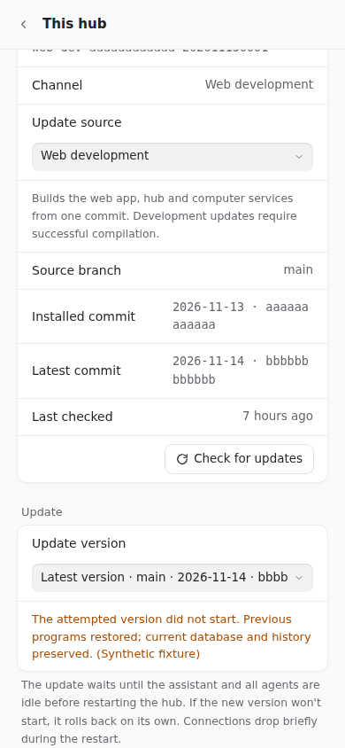

## setup-large

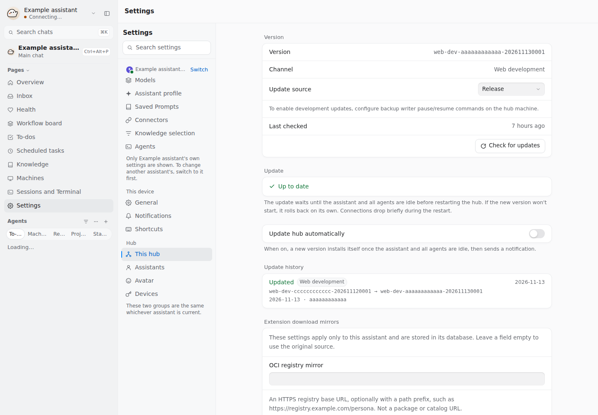
