# Web development update review captures

Source commit: `42f502226920c303960e9887c6d49d19765575cf`. Web source tree: `e71e08711e1c8654bf83e59ff4f8038c94028ad4`.

Chromium 149.0.7827.55, linux, Node v24.20.0. Full App against synthetic local API; no production data or services.

29 fresh captures: 1440x1000 / 390x844, light/dark, Standard/maximum Web Large. Source/automation/backup/idle/forced-confirm interaction assertions passed; no uncaught browser errors or page overflow. Author visual inspection is not maintainer approval.

See capture.json for source binding and interactions; SHA256SUMS binds every image.

## 1440-dark-large-options

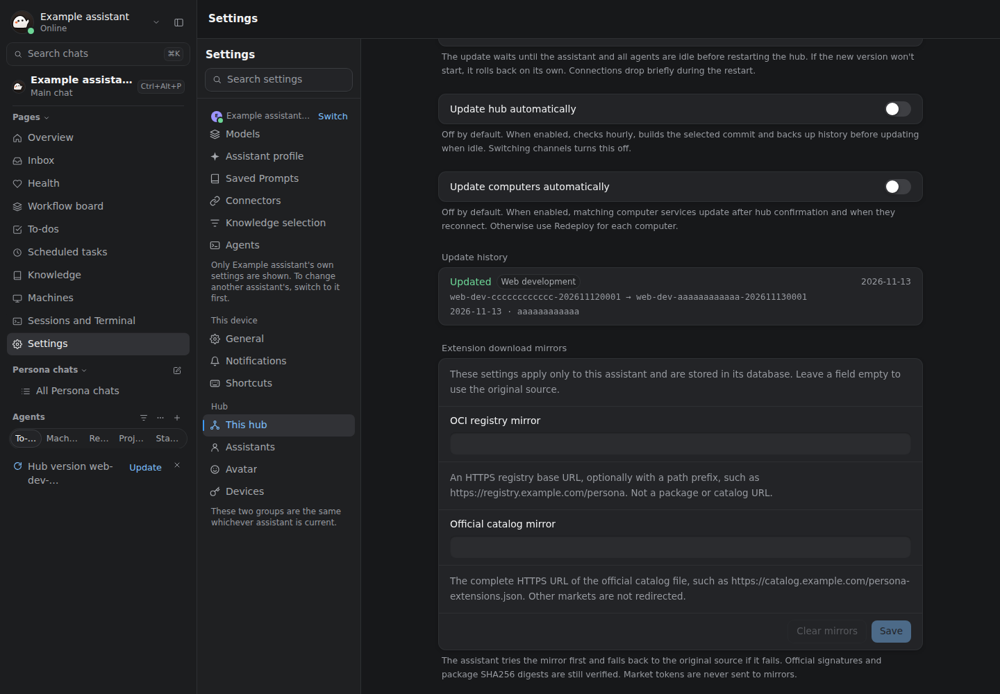

## 1440-dark-large-source

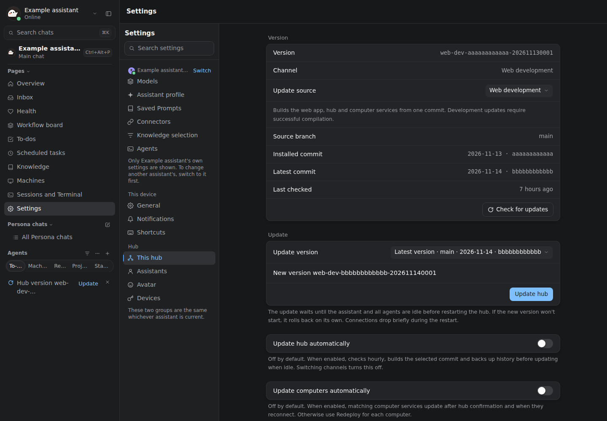

## 1440-dark-standard-options

## 1440-dark-standard-source

## 1440-light-large-options

## 1440-light-large-source

## 1440-light-standard-options

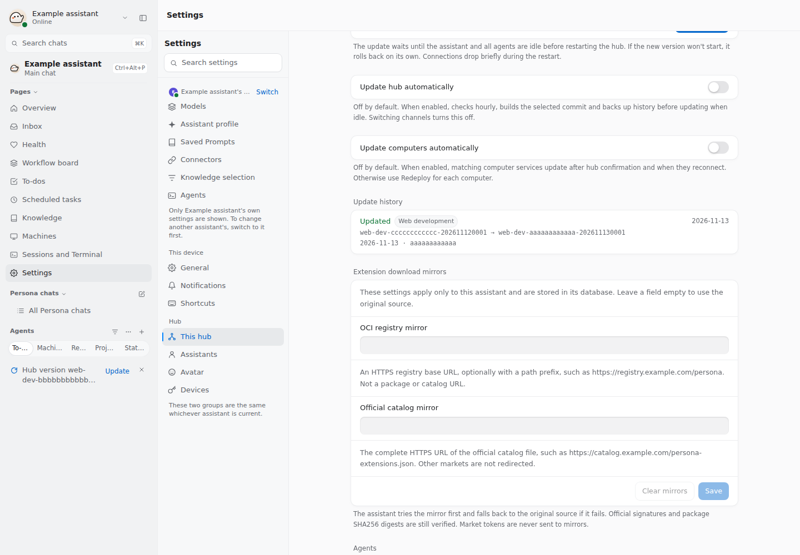

## 1440-light-standard-source

## 390-dark-large-options

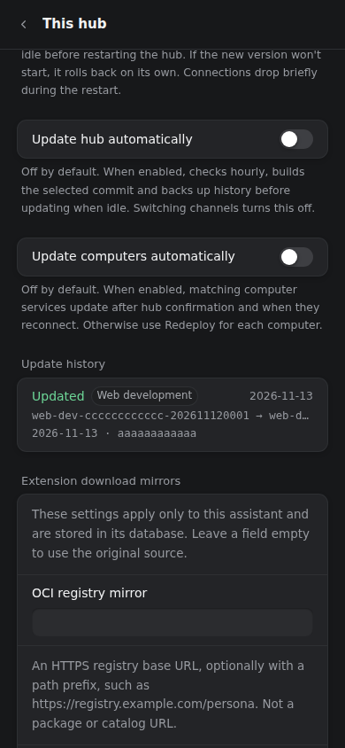

## 390-dark-large-source

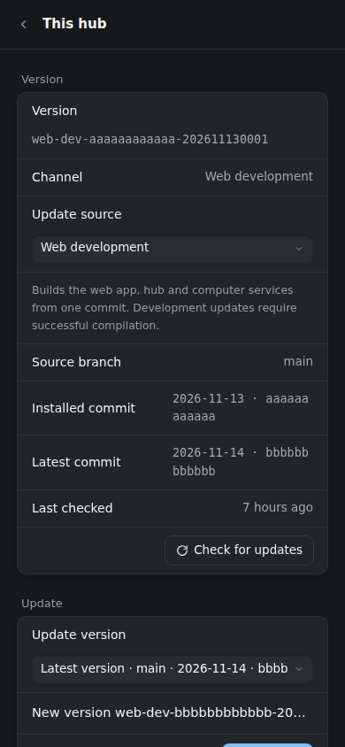

## 390-dark-standard-options

## 390-dark-standard-source

## 390-light-large-options

## 390-light-large-source

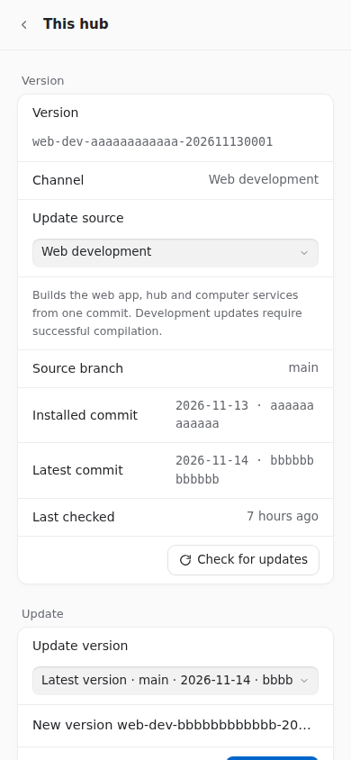

## 390-light-standard-options

## 390-light-standard-source

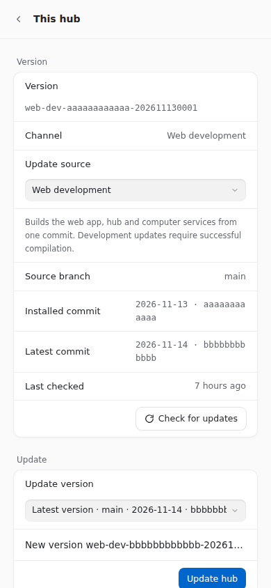

## automatic-enabled

## backing_up-large

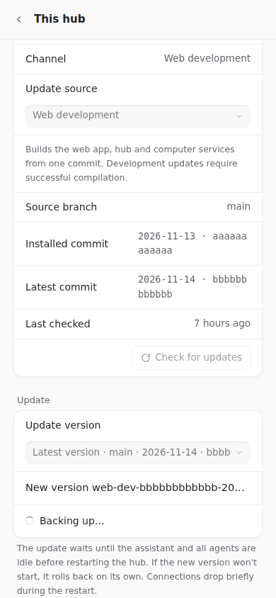

## backup-confirm-narrow-dark-large

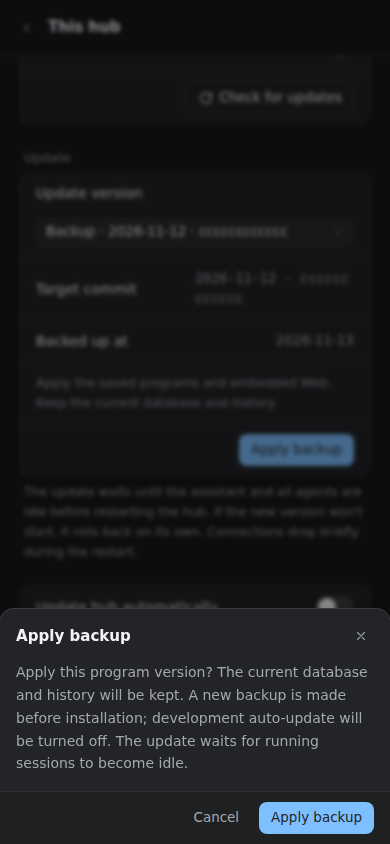

## backup-confirm

## backup-error-large

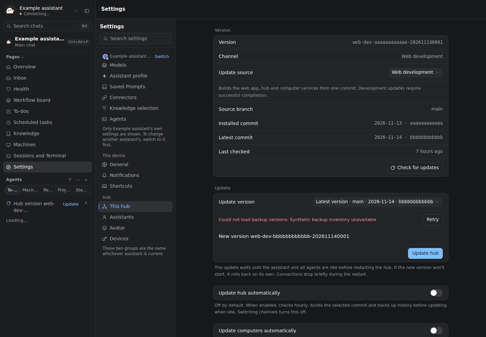

## backup-waiting

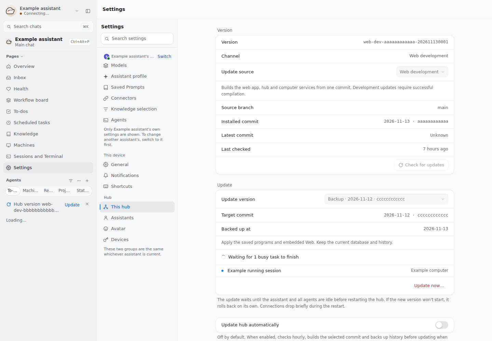

## building-large

## failed-large

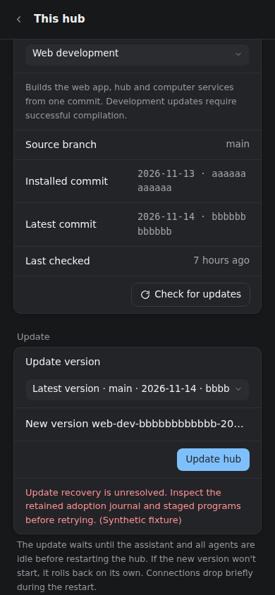

## interrupt-confirm

## release-source

## rollback-history-large

## rolled_back-large

## setup-large

