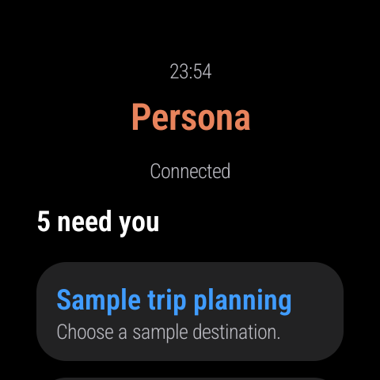
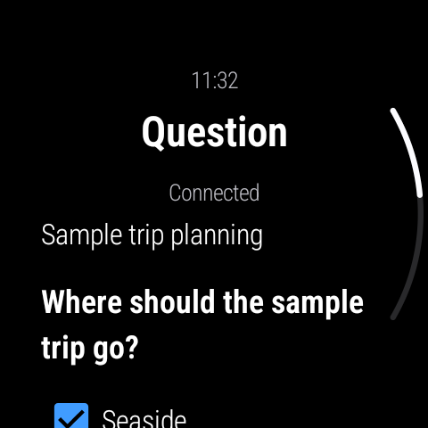
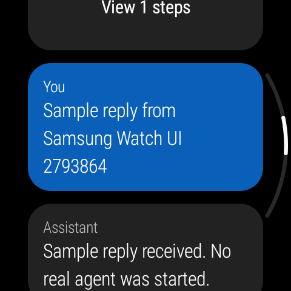
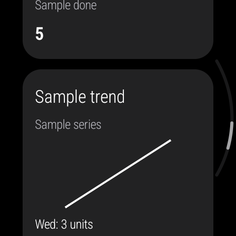

# Synthetic fixture captures

These physical-watch captures were recorded during the earlier fixture acceptance described in [QA](../../QA.md). They are illustrative evidence from that acceptance, not screenshots rerun at the final PR commit. All visible conversations, requests, replies and extension values are synthetic. The number in the sample reply is an uptime-based test nonce, not an account or session identifier.

The native Wear OS design uses a black background in both system appearance modes. This gallery does not establish a separate light theme, largest-text accessibility coverage or real-agent execution.

| Home | Question selection |
| --- | --- |
|  |  |

| Conversation reply | Extension projection |
| --- | --- |
|  |  |

Only these individually reviewed images are published. Real-Hub screenshots and the rest of the local capture directory remain excluded.
